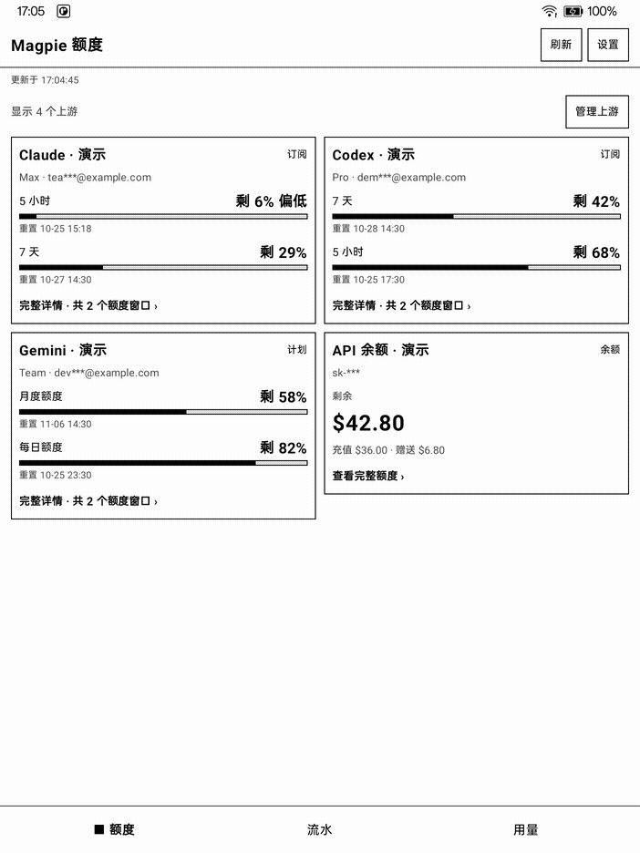
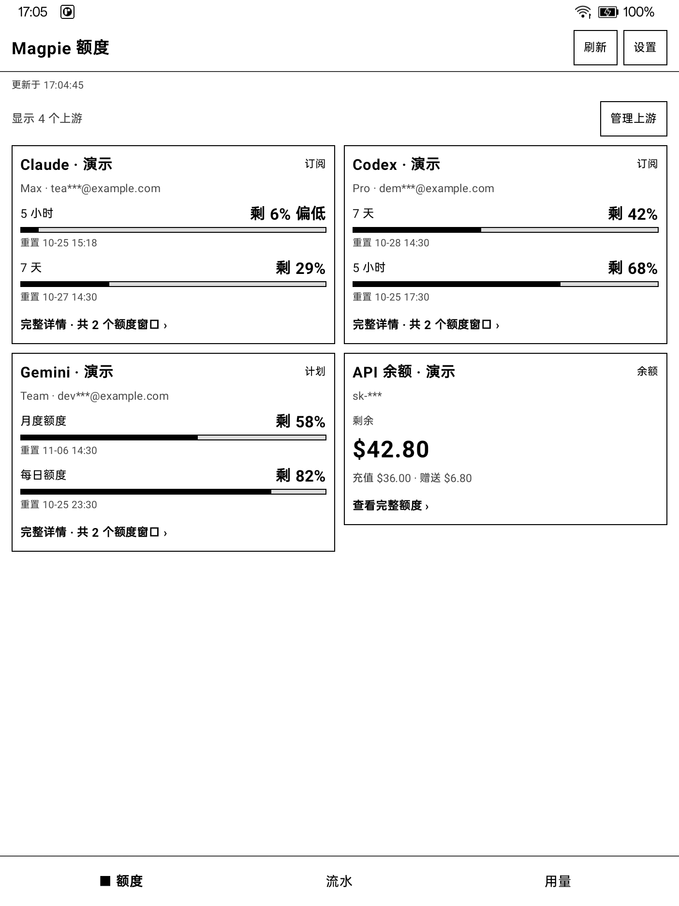
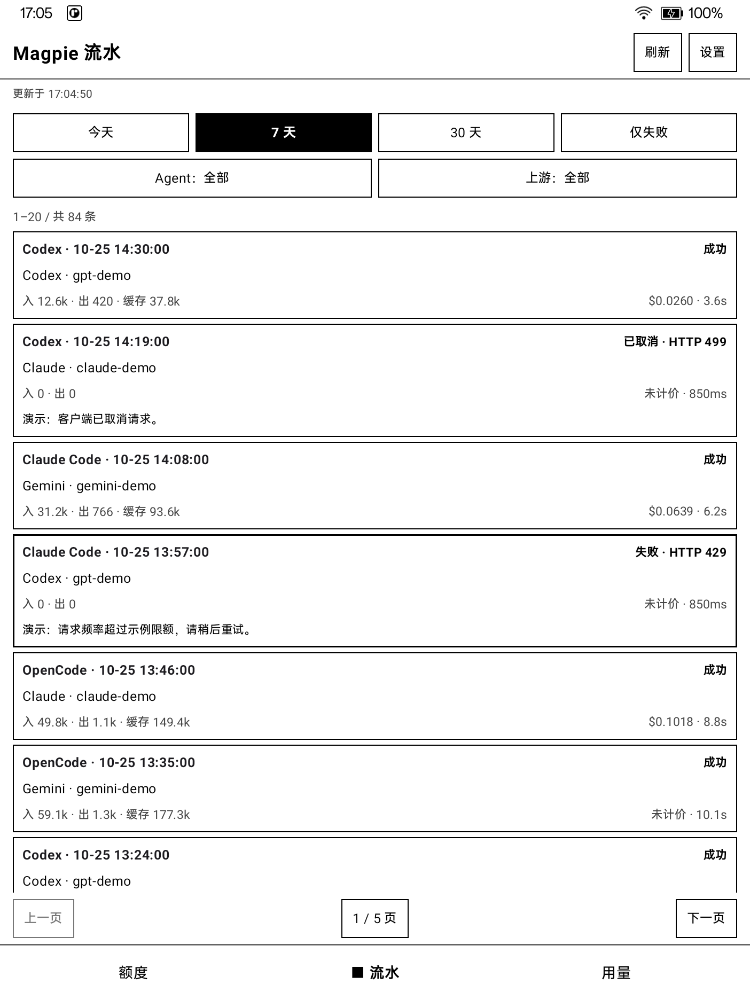
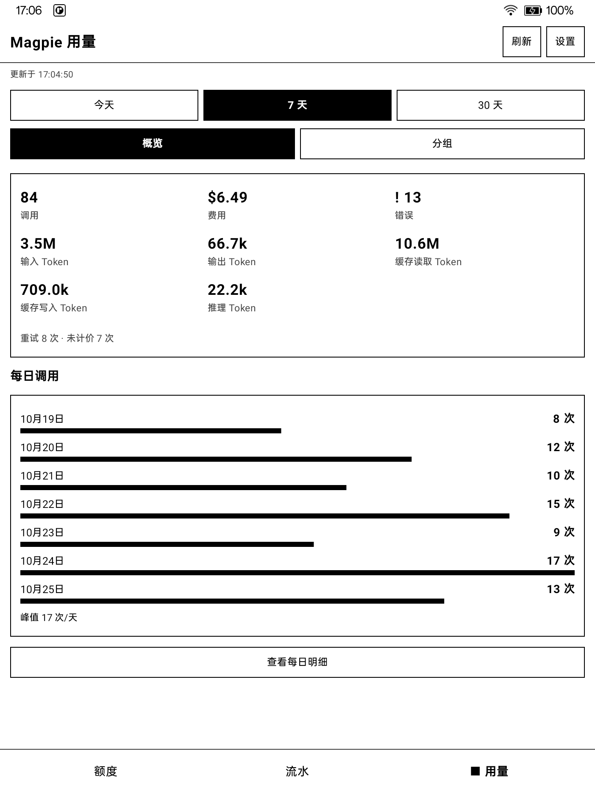

# Magpie 用量

面向 Android 墨水屏设备的 Magpie 客户端，查看额度、请求流水和用量汇总。使用 Kotlin / Jetpack Compose 构建，采用黑白界面，内置 WireGuard 与 Tailscale 网络接入，可连接自建 Headscale。

[项目介绍与演示](https://jianyun8023.github.io/magpie-usage-app/) · [GitHub 仓库](https://github.com/jianyun8023/magpie-usage-app)



## 功能

- **额度**：查看上游额度与重置窗口，展开完整详情，按卡片或全部手动刷新，显示余额明细，隐藏不关心的上游。
- **流水**：按时间、Agent、上游及失败状态筛选，分页或跳页，查看请求详情。
- **用量**：查看今天、7 天、30 天的调用、费用与 Token 汇总，以及小时、每日和分组明细；按设备时区请求数据。
- **网络**：导入 WireGuard `.conf`，或登录 Tailscale / Headscale，连接、断开并查看状态。

| 额度 | 流水 | 用量 |
| --- | --- | --- |
|  |  |  |

图片展示真实 App 界面，使用演示数据与打码示例账号，非真实账户及历史记录。GIF 按额度、流水、用量轮播展示截图。

## 使用

需要 **Android 11（API 30）或以上的 ARM 设备**，支持 `arm64-v8a`、`armeabi-v7a`。当前构建不包含 x86 / x86_64 原生库。

在运行 Magpie 的机器上开启「Share on local network（局域网共享）」，创建或选择网关 API Key。无需另开 `magpie web`。

在 App 的「服务器设置」中填写模型网关地址和网关 API Key，先「测试连接」，再「保存」。例如 `http://192.0.2.10:3425`；这是示例地址，请替换为实际可达地址和网关端口。旧版连接 Web 服务的用户需重新填写网关地址和 Key，原有 Web Key 不能代替网关 Key。

客户端使用 `Authorization: Bearer <网关 API Key>` 访问以下接口：

| 功能 | 接口 |
| --- | --- |
| 用量汇总 | `GET /v1/magpie/usage` |
| 请求流水 | `GET /v1/magpie/usage/requests` |
| 额度卡片（缓存） | `GET /v1/magpie/quotas/cards` |
| 手动刷新额度 | `POST /v1/magpie/quotas/refresh` |

额度卡片从返回值的 `data` 数组读取；手动刷新由服务端按卡片限频，最多每 30 秒一次。服务端须提供这些接口，出现 404 时检查网关地址和 Magpie 版本。受预算、模型或账号限制的 Key 无权读取全局用量汇总，流水只包含自身请求；额度读取需由所有者另行授权。此 Key 是 Magpie 网关的访问凭据，不是模型提供商的 API Key。HTTP 不加密传输，远程访问应使用受信任的 HTTPS 或 VPN。

### 应用内网络

在「服务器设置 → 网络接入」中选择直连、WireGuard 或 Tailscale。WireGuard 和 Tailscale 仅承载本应用的服务请求，不创建 Android 系统 VPN，也不改变其他应用的网络。

- **WireGuard**：导入 `.conf` 后连接；访问范围由配置中的 `AllowedIPs` 等路由设置决定。
- **Tailscale**：控制服务器留空使用官方服务；连接 Headscale 时填写其控制服务器 URL，保存并按授权页面完成登录。服务地址支持 Tailnet IP 与网络内的 MagicDNS 名称；未知域名不会回落系统 DNS。更换控制服务器会断开并退出当前账号。

WireGuard 与 Tailscale 互斥，切换时会先断开另一种。选择的应用内连接断开或失败时，请求会报错；如需直接访问，须明确选择「直连」。内置引擎不需要另装对应客户端，但仍需可用的服务端和账号授权。连接状态不等于 Magpie 服务可达，连接后仍需测试服务器地址。连接随应用进程存活；冷启动会恢复所选 Tailscale，WireGuard 需手动重连。

## 构建与测试

推荐使用 JDK 17 或 21，并准备 Android SDK Platform 34、Build Tools 34.0.0 和 Platform Tools。项目使用 Gradle 8.7；通过 `ANDROID_HOME` 或未纳入版本控制的 `local.properties` 指定 SDK 目录。

```sh
git clone https://github.com/jianyun8023/magpie-usage-app.git
cd magpie-usage-app
./gradlew :app:assembleDebug
```

Debug APK 位于 `app/build/outputs/apk/debug/app-debug.apk`。连接开启 USB 调试的 ARM 设备后可安装：

```sh
adb install -r app/build/outputs/apk/debug/app-debug.apk
```

单元测试与静态检查：

```sh
./gradlew :app:testDebugUnitTest :app:lintDebug
```

在已连接设备上运行配置重建回归测试：

```sh
./gradlew :app:connectedDebugAndroidTest \
  -Pandroid.testInstrumentationRunnerArguments.class=com.jianyun.x2app.data.SettingsStoreRecreationTest
```

该测试使用本机回环 HTTP 服务，真实重建 Activity，确认保留的 ViewModel 使用更新后的地址和 Bearer 鉴权，并在结束时恢复原有服务器与隐藏额度配置。

仓库包含 `app/libs/libappnet.aar`，普通 APK 构建无需重编 Go 引擎。引擎使用 WireGuard 用户态网络栈与 Tailscale `tsnet`。原生库来源、固定版本、构建脚本和第三方声明见 [third_party/appnet](third_party/appnet/README.md)。

## 验证与已知限制

目前通过 98 项 Kotlin 单元测试、21 项 Go 测试（含竞态检查），Debug / Release 构建和 lint 检查均通过（lint 无错误，仍有 16 项警告）。Note X2 / Android 11 真机通过 5 项测试：WireGuard 加密 HTTP 与断开后不回落直连、Headscale IP / MagicDNS HTTP 与断开后身份复用、无系统 VPN 服务声明、加密状态存储、Activity 重建时配置更新与恢复。真机 UI 按字体缩放 1.15 检查。

- 官方 Tailscale 已在真机确认登录、子网访问及身份复用重连；应用进程启动时会自动恢复已选择的 Tailscale，但不提供设备开机后的后台自启。其他设备、ROM 和字体缩放仍需验证。
- **Magpie 网关 API Key 目前存于普通 SharedPreferences，未加密，且未从系统备份中排除。** VPN 配置的加密存储不代表所有凭据都已加密。
- 部分 ROM 会在崩溃后禁用测试包，造成测试关闭时的 `EmptyActivity` 异常。若确认测试包被禁用，可执行 `adb shell pm enable com.jianyun.x2app.test` 后重跑。

项目目前未声明仓库级开源许可证；第三方组件按各自许可证使用，其声明见 [应用内网络第三方目录](third_party/appnet/README.md)。

## CI 与发布

[下载最新 Release APK](https://github.com/jianyun8023/magpie-usage-app/releases/latest) · [构建状态](https://github.com/jianyun8023/magpie-usage-app/actions/workflows/android.yml)

推送 main 或提交 PR 时，GitHub Actions 自动构建 Debug APK、运行单元测试与 lint，并保留 APK 和检查报告 14 天。真机 instrumentation 测试仍需连接 ARM 设备运行。

版本标签（例如 `v0.1.0`）须与 `versionName` 一致，检查通过后构建签名 Release APK，发布到 GitHub Release，附带 SHA256 校验文件。签名使用仓库 Secrets `RELEASE_KEYSTORE_BASE64` 和 `RELEASE_KEYSTORE_PASSWORD`；后续版本必须沿用同一密钥。本地签名备份位于被 Git 忽略的 `.release-signing/`，不要提交或公开。

概览及 Agent、模型、账号分组的“总计 Token”均为输入 + 输出 + 缓存读取 + 缓存写入，与 Magpie「含缓存」口径一致；推理 Token 已计入输出，不重复加入。正式 Release 签名与本地 Debug 签名不同，切换安装前应保存原有配置。
